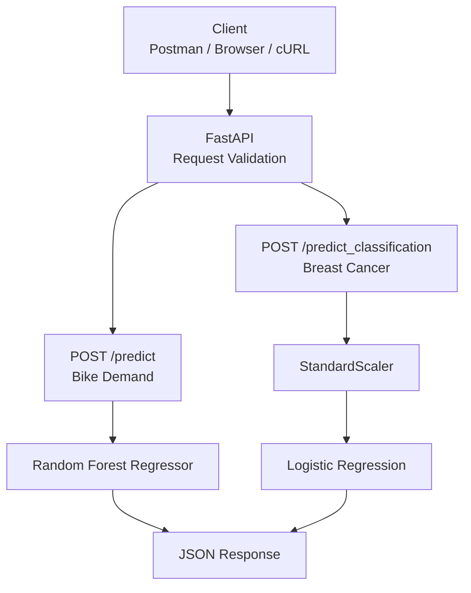
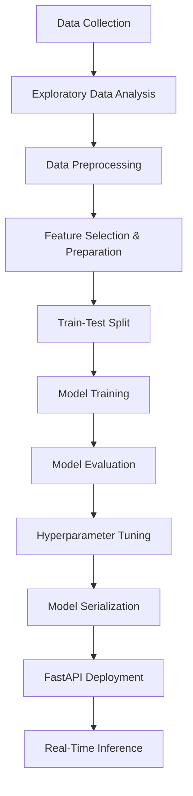

<h1 align="center">🚴 Bike Demand Prediction & ML Classification API</h1>

<p align="center">
  <strong>Regression · Classification · FastAPI · Scikit-learn</strong><br/>
  Two trained ML models served through one REST API.
</p>

<p align="center">
  
  
  
  
  
  
</p>

---

## 📑 Table of Contents

- [Overview](#-overview)
- [Key Features](#-key-features)
- [Tech Stack](#️-tech-stack)
- [Architecture](#️-architecture)
- [Project Structure](#-project-structure)
- [Installation & Setup](#️-installation--setup)
- [API Documentation](#-api-documentation)
- [Bike Demand Prediction](#-1-bike-demand-prediction)
- [Breast Cancer Classification](#-2-breast-cancer-classification)
- [Machine Learning Workflow](#-machine-learning-workflow)
- [Model Evaluation](#-model-evaluation)
- [API Endpoints Summary](#-api-endpoints-summary)
- [Future Improvements](#-future-improvements)
- [License](#-license)

---

## 📌 Overview

This project develops and deploys machine learning models behind a RESTful API built with **FastAPI**. It combines two applications in a single service:

- 🚴 **Bike Demand Prediction** – a regression model that predicts bike rental demand from environmental, seasonal, and time-related features.
- 🧬 **Breast Cancer Classification** – a classification model that predicts whether a breast tumor is malignant or benign from cell-nuclei measurements.

Both trained models are serialized with Joblib and loaded by the API to serve predictions over HTTP.

## ✨ Key Features

- **Two ML applications** – regression and classification in one API
- **Random Forest Regression** – predicts bike rental demand
- **Logistic Regression** – classifies breast tumor measurements
- **Data preprocessing** – `StandardScaler` normalizes classification inputs
- **Model persistence** – models saved and loaded with Joblib, tracked via Git LFS
- **Input validation** – Pydantic models validate every request
- **Interactive docs** – Swagger UI and OpenAPI documentation generated automatically
- **Modular inference** – each model has its own endpoint

## 🛠️ Tech Stack

| Technology | Purpose |
|---|---|
| Python | Core programming language |
| FastAPI | REST API development |
| Scikit-learn | Machine learning algorithms |
| Pandas | Data manipulation |
| NumPy | Numerical computing |
| Joblib | Model serialization and loading |
| Pydantic | Request validation |
| Uvicorn | ASGI server |

## 🏗️ Architecture



## 📂 Project Structure

```text
ml-prediction-api/
│
├── main.py
├── predict.py
│
├── random_forest_model.pkl
├── logistic_regression.pkl
├── scaler.pkl
│
├── bike+sharing+dataset/
│   ├── Readme.txt
│   ├── day.csv
│   └── hour.csv
│
├── notebook_classification/
├── notebook_regression/
│
├── requirements.txt
├── .gitattributes
├── .gitignore
└── README.md
```

**Model artifacts (stored via Git LFS):**

| File | Description |
|---|---|
| `random_forest_model.pkl` | Trained Random Forest Regressor |
| `logistic_regression.pkl` | Trained Logistic Regression Classifier |
| `scaler.pkl` | Fitted StandardScaler used for classification |

## ⚙️ Installation & Setup

### 1. Clone the Repository (with Git LFS)

Make sure [Git LFS](https://git-lfs.com/) is installed so the `.pkl` model files download properly:

```bash
git lfs install
git clone https://github.com/sidharth-chauhan/ml-prediction-api.git
cd ml-prediction-api
git lfs pull
```

### 2. Create a Virtual Environment

```bash
python3 -m venv venv
```

### 3. Activate the Environment

**macOS / Linux**

```bash
source venv/bin/activate
```

**Windows**

```bash
venv\Scripts\activate
```

### 4. Install Dependencies

```bash
pip install -r requirements.txt
```

### 5. Start the FastAPI Server

```bash
uvicorn main:app --reload
```

The application will run at `http://127.0.0.1:8000`.

## 📖 API Documentation

FastAPI generates interactive documentation automatically.

| Documentation | URL |
|---|---|
| Swagger UI | http://127.0.0.1:8000/docs |
| ReDoc | http://127.0.0.1:8000/redoc |
| Root Endpoint | http://127.0.0.1:8000/ |

## 🚴 1. Bike Demand Prediction

**Endpoint:** `POST /predict`
**Algorithm:** Random Forest Regressor
**Problem Type:** Regression

### Input Features

| Feature | Description |
|---|---|
| `season` | Season of the year |
| `yr` | Year indicator |
| `mnth` | Month |
| `hr` | Hour of the day |
| `holiday` | Whether the day is a holiday |
| `weekday` | Day of the week |
| `workingday` | Whether the day is a working day |
| `weathersit` | Weather situation |
| `temp` | Normalized temperature |
| `atemp` | Normalized feeling temperature |
| `hum` | Normalized humidity |
| `windspeed` | Normalized wind speed |

### Example Request

```json
{
  "season": 2,
  "yr": 1,
  "mnth": 6,
  "hr": 17,
  "holiday": 0,
  "weekday": 3,
  "workingday": 1,
  "weathersit": 1,
  "temp": 0.65,
  "atemp": 0.62,
  "hum": 0.45,
  "windspeed": 0.15
}
```

### Example Response

```json
{
  "prediction": 245.0
}
```

> The prediction above is illustrative; actual output depends on the trained model and input.

## 🧬 2. Breast Cancer Classification

**Endpoint:** `POST /predict_classification`
**Algorithm:** Logistic Regression
**Problem Type:** Binary Classification

The model uses 30 numerical features describing cell nuclei, computed from digitized images of fine needle aspirates (FNA) of breast masses.

### Prediction Classes

| Output | Meaning |
|---|---|
| `0` | Malignant |
| `1` | Benign |

### Preprocessing

Inputs are standardized with **StandardScaler** before prediction:

$$z = \frac{x - \mu}{\sigma}$$

Where:

- $x$ = original feature value
- $\mu$ = training mean
- $\sigma$ = training standard deviation

The same fitted scaler used during training is loaded at inference time.

### Input Features

The API expects these 30 features:

| # | Mean | Error | Worst |
|---|---|---|---|
| 1 | `mean_radius` | `radius_error` | `worst_radius` |
| 2 | `mean_texture` | `texture_error` | `worst_texture` |
| 3 | `mean_perimeter` | `perimeter_error` | `worst_perimeter` |
| 4 | `mean_area` | `area_error` | `worst_area` |
| 5 | `mean_smoothness` | `smoothness_error` | `worst_smoothness` |
| 6 | `mean_compactness` | `compactness_error` | `worst_compactness` |
| 7 | `mean_concavity` | `concavity_error` | `worst_concavity` |
| 8 | `mean_concave_points` | `concave_points_error` | `worst_concave_points` |
| 9 | `mean_symmetry` | `symmetry_error` | `worst_symmetry` |
| 10 | `mean_fractal_dimension` | `fractal_dimension_error` | `worst_fractal_dimension` |

### Example Request

```json
{
  "mean_radius": 14.5,
  "mean_texture": 20.0,
  "mean_perimeter": 95.0,
  "mean_area": 650.0,
  "mean_smoothness": 0.1,
  "mean_compactness": 0.12,
  "mean_concavity": 0.1,
  "mean_concave_points": 0.05,
  "mean_symmetry": 0.19,
  "mean_fractal_dimension": 0.06,
  "radius_error": 0.3,
  "texture_error": 1.0,
  "perimeter_error": 2.0,
  "area_error": 25.0,
  "smoothness_error": 0.006,
  "compactness_error": 0.02,
  "concavity_error": 0.02,
  "concave_points_error": 0.01,
  "symmetry_error": 0.02,
  "fractal_dimension_error": 0.003,
  "worst_radius": 17.0,
  "worst_texture": 25.0,
  "worst_perimeter": 115.0,
  "worst_area": 900.0,
  "worst_smoothness": 0.14,
  "worst_compactness": 0.25,
  "worst_concavity": 0.25,
  "worst_concave_points": 0.1,
  "worst_symmetry": 0.3,
  "worst_fractal_dimension": 0.08
}
```

### Example Response

```json
{
  "prediction": "Benign",
  "raw_prediction": 1
}
```

> The prediction above is illustrative; actual output depends on the trained model and input.

## 🧠 Machine Learning Workflow



## 📊 Model Evaluation

| Problem Type | Metrics |
|---|---|
| Regression | MAE, MSE, RMSE, R² Score |
| Classification | Accuracy, Precision, Recall, F1-Score, Confusion Matrix |

## 🔌 API Endpoints Summary

| Method | Endpoint | Description |
|---|---|---|
| `GET` | `/` | Welcome endpoint |
| `POST` | `/predict` | Predict bike rental demand |
| `POST` | `/predict_classification` | Classify breast tumor measurements |

### Quick Test

1. Open Swagger UI at `/docs`.
2. Select a prediction endpoint.
3. Click **Try it out**.
4. Enter the JSON input.
5. Click **Execute** and view the response.

You can also test with Postman or any HTTP client.

## 🔮 Future Improvements

- [ ] Add model comparison and experiment tracking
- [ ] Improve performance through additional feature engineering
- [ ] Add automated model evaluation
- [ ] Introduce Docker-based deployment
- [ ] Deploy the API to a cloud platform
- [ ] Add automated testing with Pytest
- [ ] Implement CI/CD workflows
- [ ] Add structured logging and API monitoring

## 📄 License

This project is available under the **MIT License**.

---

<p align="center">Made with ❤️ using FastAPI and Scikit-learn</p>
